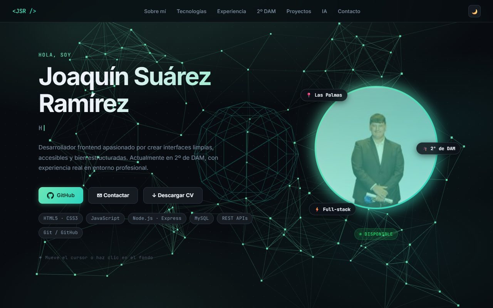
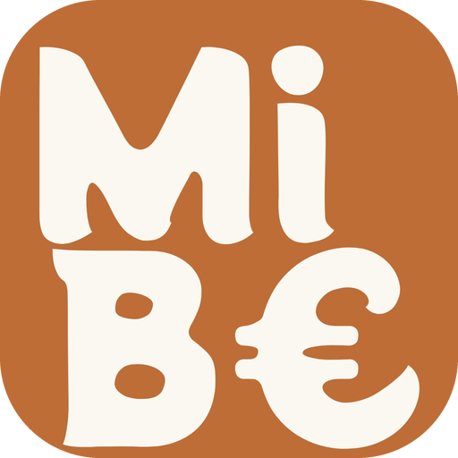
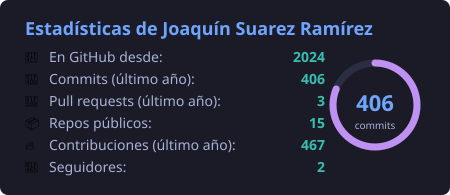
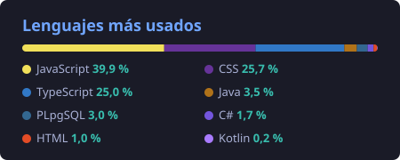

  

**[🌐 Portafolio](#-mi-portafolio)** · **[🚀 Sobre mí](#-sobre-mí)** · **[📂 Proyectos](#-proyectos-destacados)** · **[📫 Contacto](#-contacto)**

---

## 🌐 Mi portafolio

Un portafolio hecho con **HTML, CSS y JavaScript** (sin frameworks) que **se construye en vivo mientras haces scroll**: cursores que escriben el texto letra a letra, fotos que se redimensionan como en un editor visual y una **esfera 3D con three.js** de las tecnologías que uso, que se puede arrastrar y filtrar.

- 🧊 Escena 3D interactiva y constelación tecnológica
- 🎓 Lo que he aprendido en **2º de DAM**, con los proyectos donde lo apliqué
- 🤖 Cómo trabajo con **Claude Code**, subagentes y skills
- 📦 [Código fuente](https://github.com/Haise232/Portafolio) · Publicado con GitHub Pages

  

---

## 🚀 Sobre mí

<table align="center">
  <tr>
    <td width="220" align="center">
      
    </td>
    <td>
      
👋 Soy <b>Joaquín</b>, de Ingenio (Las Palmas de Gran Canaria).

      <ul>
        <li>🎓 Cursando <b>2º del Grado Superior en DAM</b> (CIFP Villa de Agüimes)</li>
        <li>💼 Prácticas en el <b>Ayuntamiento de Agüimes</b>: intranet, redes y soporte</li>
        <li>⚛️ <b>React + TypeScript</b> y apps con <b>Expo / React Native</b></li>
        <li>📱 <b>Kotlin y Jetpack Compose</b> para Android nativo</li>
        <li>☕ <b>Java y Spring Boot</b> para APIs · 🖥️ <b>C#</b> para escritorio</li>
        <li>🤖 Trabajo con <b>Claude Code</b> y agentes para ir más rápido sin perder el control del código</li>
      </ul>
      
<i>Una gran lección: <b>si funciona, mejor no tocarlo</b> 😅🙏</i>

    </td>
  </tr>
</table>

---

## 🛠️ Tecnologías

<table>
  <tr>
    <td><b>🎨 Frontend</b></td>
    <td>
      
      
      
      
      
      
      
      
    </td>
  </tr>
  <tr>
    <td><b>📱 Móvil</b></td>
    <td>
      
      
      
      
      
    </td>
  </tr>
  <tr>
    <td><b>⚙️ Backend</b></td>
    <td>
      
      
      
      
      
    </td>
  </tr>
  <tr>
    <td><b>🖥️ Escritorio</b></td>
    <td>
      
      
      
    </td>
  </tr>
  <tr>
    <td><b>🗄️ Datos y Cloud</b></td>
    <td>
      
      
      
      
      
      
      
    </td>
  </tr>
  <tr>
    <td><b>🧰 Herramientas e IA</b></td>
    <td>
      
      
      
      
      
      
    </td>
  </tr>
</table>

---

## 📂 Proyectos destacados

### 👑 TopCode

<table>
  <tr>
    <td width="120" align="center">
      
    </td>
    <td>
      <h3><a href="https://github.com/Haise232/TopCode">TopCode</a> 👑</h3>
      
La intranet académica para estudiantes de <b>DAM, DAW y ASIR</b>: actividades, calendario, apuntes, documentación en Markdown, foro de dudas, recursos y chat en tiempo real. Web + app móvil, con acceso aprobado por administradores y permisos por clase.

      

        
        
      

      

        
        
        
        
        
        
      

    </td>
  </tr>
</table>

### 🥈 GcGames

<table>
  <tr>
    <td width="120" align="center">
      
    </td>
    <td>
      <h3><a href="https://github.com/Haise232/GcGames">GcGames</a> 🎰</h3>
      
Un <b>casino online</b> con dinero ficticio para jugar con tu gente: mesas en vivo de blackjack, póker y ajedrez, rondas para todos a la vez (ruleta, cohete, carrera, bingo…), juegos en solitario como <b>Pez Gordo</b> y <b>Tesoro en la Arena</b>, gacha de cartas, pase de temporada y una economía semanal con su propia Hacienda. Todo lo sortea el servidor: el navegador solo pinta.

      

        
        
      

      

        
        
        
        
        
      

    </td>
  </tr>
</table>

### 🥉 MiBalance

<table>
  <tr>
    <td width="120" align="center">
      
    </td>
    <td>
      <h3><a href="https://github.com/Haise232/MiBalance">MiBalance</a> 💰</h3>
      
App de <b>finanzas personales</b> multiplataforma (Android, iOS y web): ingresos, gastos, cuentas, categorías, deudas, suscripciones y reportes con gráficos. Tema claro/oscuro, recordatorios diarios, copias de seguridad en CSV/JSON y datos por usuario con Supabase.

      

        
        
      

      

        
        
        
        
        
      

    </td>
  </tr>
</table>

<b>🗂️ Ver todos los proyectos</b>

#### 🌐 Web y apps multiplataforma

| Proyecto | Tecnologías | Qué es |
|----------|-------------|--------|
| 👑 **[TopCode](https://github.com/Haise232/TopCode)** | React, TypeScript, Expo, Supabase | Intranet académica para DAM, DAW y ASIR: actividades, calendario, apuntes, foro y chat en tiempo real. Web + app móvil · [demo](https://topcode-2na.pages.dev) |
| 🥈 **[GcGames](https://github.com/Haise232/GcGames)** | React, Vite, Cloudflare Workers, Supabase | Casino online con dinero ficticio: mesas en vivo, rondas para todos a la vez, juegos en solitario, gacha y pase de temporada · [jugar](https://play.gcgames.workers.dev) |
| 🥉 **[MiBalance](https://github.com/Haise232/MiBalance)** | React Native, TypeScript, Expo, Supabase | Finanzas personales para Android, iOS y web: gastos, deudas, suscripciones y reportes · [demo](https://mibalanceapp.vercel.app) |
| [¿Quién es ese Pokémon?](https://github.com/Haise232/Pokemon) | HTML, CSS, JavaScript | Juego de adivinar el Pokémon por su silueta, con varios modos y cartas TCG coleccionables |
| [Calculadora](https://github.com/Haise232/Calculadora-React) | React Native, Expo, TypeScript | Calculadora para móvil (iOS y Android) y web |

#### ☕ APIs y backend

| Proyecto | Tecnologías | Qué es |
|----------|-------------|--------|
| [Rally Islas Canarias 2026](https://github.com/Haise232/rally-canarias) | Java, Spring Boot, Spring Security, PostgreSQL, Docker | API REST del rally: etapas, tramos, pilotos y equipos, con escritura protegida por API key y despliegue en Docker |
| [Gestor de Libros](https://github.com/Haise232/Act1.Ens-Apr-API-Spring-Boot) | Java, Spring Boot, MySQL | API REST por capas con CRUD de un catálogo de libros |

#### 📱 Android y escritorio

| Proyecto | Tecnologías | Qué es |
|----------|-------------|--------|
| [FaceSage](https://github.com/Haise232/FaceSage) | C#, .NET, OpenCV, ONNX Runtime | App de Windows que detecta tu cara y tus manos con la webcam y te pone accesorios y sonidos según el gesto |
| [DAMFlix](https://github.com/Haise232/DAMFlix) | Kotlin, Jetpack Compose | Pantalla de perfil de un crítico de cine para Android |
| [Gestor de Notas con Usuarios](https://github.com/Haise232/Act.Ev-UT5.2-Gestor-de-Notas-con-Usuarios) | Java, Swing | Notas personales por usuario, con contraseñas guardadas como hash SHA-256 |
| [Sistema de Notas por Usuario](https://github.com/Haise232/Act.Ev-UT5.1-Sistema-de-Notas-por-Usuario) | Java, Swing | Registro, inicio de sesión y notas guardadas en ficheros |

#### 🎓 Programación orientada a objetos (Java)

| Proyecto | Qué practica | Qué es |
|----------|--------------|--------|
| [Sistema de Biblioteca](https://github.com/Haise232/Act1.Ev-UT4.-Sistema-de-Biblioteca-con-MVC) | Patrón MVC · en equipo | Gestión de libros, usuarios y préstamos |
| [Personajes de Videojuego](https://github.com/Haise232/Act3.Ev-UT4.-Sistema-de-Personajes-de-Videojuego) | Herencia, polimorfismo e interfaces · en equipo | Personajes de videojuego de varios tipos, cada uno en su rama |
| [Pedidos de Restaurante](https://github.com/Haise232/Act.-4-Pedido-de-Restaurante) | Encapsulación y modificadores de acceso | Gestión de los pedidos de un restaurante |

---

## 📊 Estadísticas de GitHub

Se actualizan solas cada día con una GitHub Action de este repo.

  
  

---

## 📫 Contacto

  
  
  

